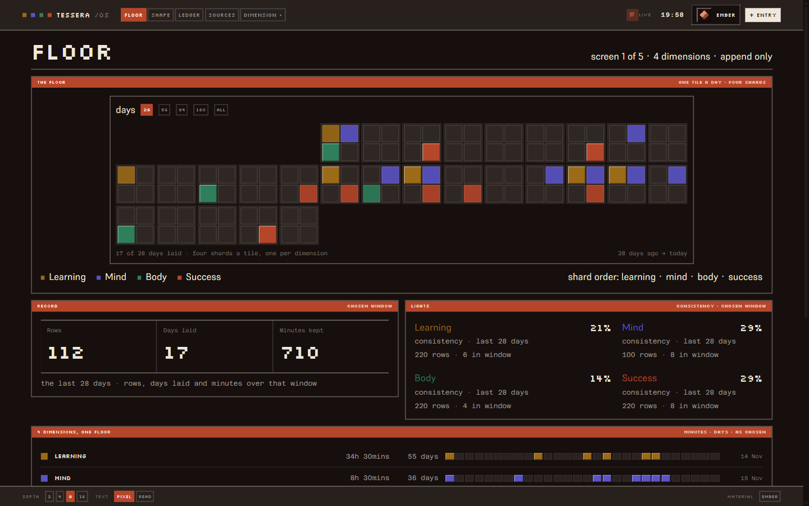
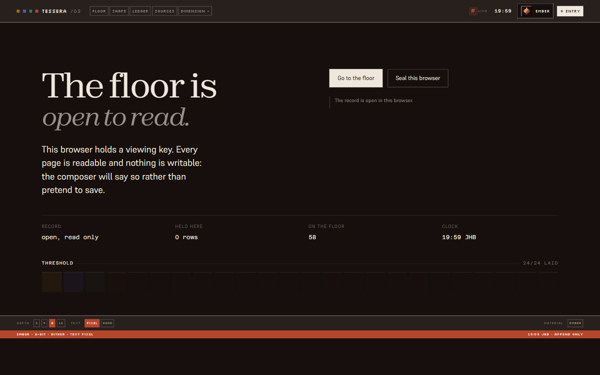
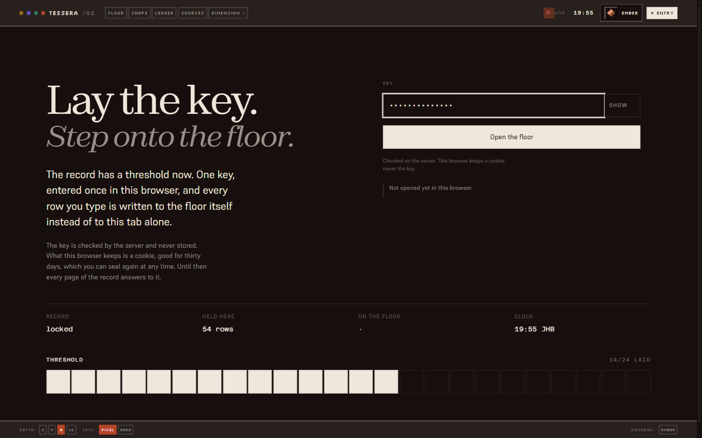
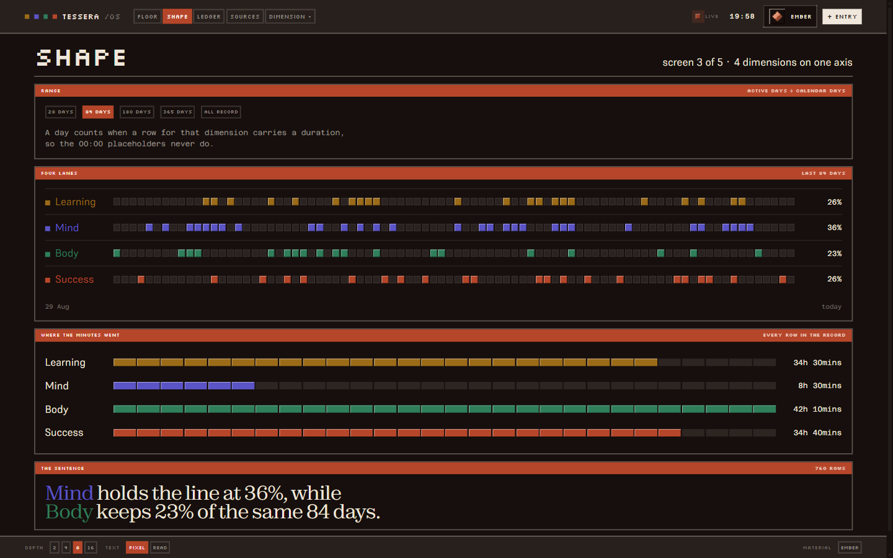
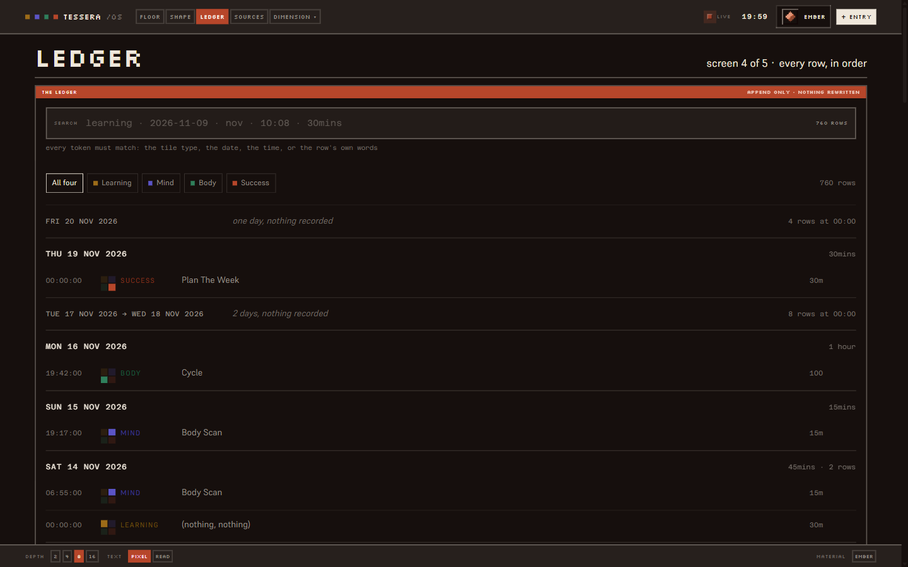
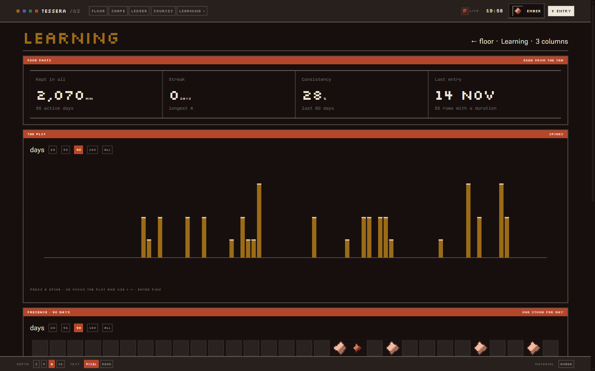
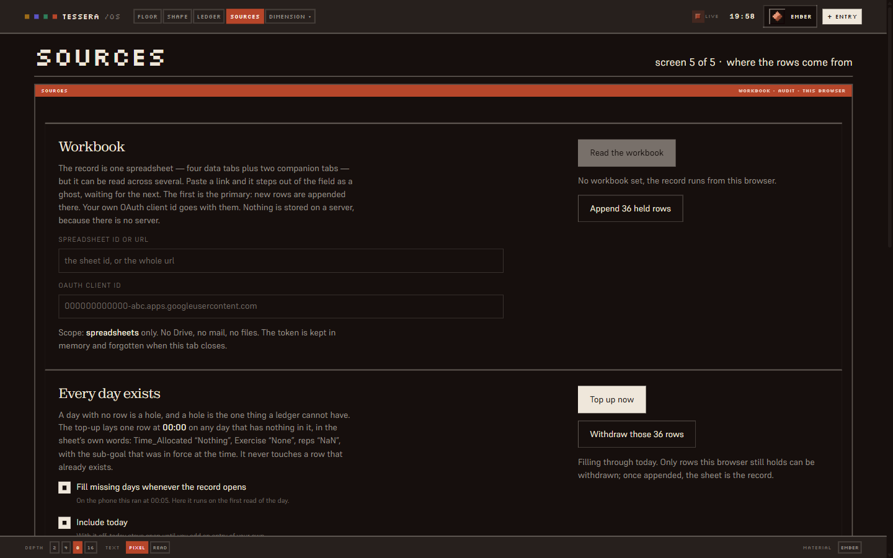
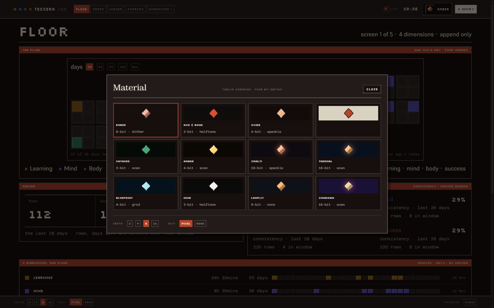

# Tessera

Four dimensions — learning, mind, body, success — kept as one record in the
browser. A tile a day, four shards to a tile, append only. One key opens it.



Next.js 16 on Cloudflare Workers, a D1 store behind a single-key threshold, and a
floor that is the record rather than a summary of it. This repository is the web app
and nothing else.

---

## The threshold

Before any page answers, `/unlock` asks for the key. Typing lays a tile per
character into a twenty-four slot course; the right key floods it with the four
smalti and lifts the curtain.





The key is checked on the server and never stored. What the browser keeps is a
cookie, good for thirty days, carrying an HMAC — never the key. Two keys can exist:

| Secret | Reads | Writes |
|---|---|---|
| `TESSERA_KEY` | every page | appends rows |
| `TESSERA_VIEW_KEY` (optional) | every page | refuses, and says so |

Rotating either one ends every session that used it.

## The floor

One tile per day, up to four shards in it, one per dimension. A shard lights when
that day has a row carrying a duration. The window selector re-cuts the floor; the
counters beneath it read whatever window is chosen.


## Shape

Consistency is active days over calendar days for the chosen window, per dimension,
drawn as lanes against the same axis so the four can be compared rather than admired.
The sentence at the foot is generated from the same numbers the lanes read.



## Ledger

Every row, in order, nothing rewritten. Tokens in the search field are ANDed across
the row's dimension, date, time and its own words.



## One dimension

Each tab gets the plot shape its data earns: spines for minutes kept, stones for
presence. Four facts sit above it, all computed from the same rows.



## Sources

Where the record came from and what is wrong with it: the audit lights, the nightly
top-up, what this browser is still holding, the server's copy, export and import.



## Material

Twelve surfaces at four bit depths, switched without a rebuild. 16-bit is the only
one that animates; everything else is a still.



---

## Run it locally

No keys, no database, no Cloudflare account:

```bash
npm install
npm run dev          # http://localhost:3000
```

The floor paints 724 synthetic rows from `src/data/seed.json` and every write stays
in the browser. The API answers `{"configured":false}` and the composer says so
rather than pretending to save.

To exercise the real Worker, with a local D1:

```bash
npm run preview
```

## Deploy

```bash
npx wrangler login
npx wrangler d1 create tessera-record     # put the printed id in wrangler.jsonc
npm run db:migrate                        # --remote; use db:migrate:local for the preview
npx wrangler secret put TESSERA_KEY       # the key you will type at /unlock
npm run deploy
```

On Windows, stop `npm run dev` first — a running dev server breaks the build. If
`npm run deploy` fails there, split it:

```bash
npm run build
npx opennextjs-cloudflare build --skipNextBuild
npx wrangler deploy
```

---

## Set it up with your agent

Paste this into your coding agent. It is written to be read by an agent and driven
by you: three steps stop and hand the terminal back, everything else it can do alone.

```text
Set up the Tessera web app in this repository on my Cloudflare account and deploy it.

Read README.md first, then work from the repository root. Ask before anything destructive.

1. npm install
2. npx wrangler login — if a browser opens, wait for me to finish it.
3. npm run dev, and confirm http://localhost:3000 paints the floor with no key and no
   database. Then STOP that server: a running dev server breaks the build in step 7.
4. npx wrangler d1 create tessera-record — write the database_id it prints into
   wrangler.jsonc, replacing the value already there.
5. npm run db:migrate — expect migrations/0001_record.sql to apply.
6. STOP and ask me to run: npx wrangler secret put TESSERA_KEY
   Do not read, print, generate or store the value. I type it into your terminal.
   Ask me separately whether I want npx wrangler secret put TESSERA_VIEW_KEY.
7. npm run deploy — then give me the deployed https URL.
8. Verify on that URL and report each result:
   - / returns 307 and redirects to /unlock
   - /unlock returns 200 and its title contains "Threshold"
   - /api/entries with no key returns 200 with "locked":true
   - /api/unlock with a wrong key returns 401
9. Tell me what you changed, and every result in step 8 that did not match.

Never commit a secret. Never echo a key into a command line, a log or a chat.
```

**Why those three stops.** `wrangler login` needs your browser. `secret put` reads
the key from stdin so the value exists in your terminal and nowhere else — an agent
that helps there has already seen it. `deploy` puts the record in front of the
public internet, so it happens on your word.

**What it will report back if it worked** — these are the real answers, measured:

| Check | Expected |
|---|---|
| `GET /` | `307` → `/unlock` |
| `GET /unlock` | `200`, title `Threshold · Tessera` |
| `GET /api/entries`, no key | `200` `{"configured":true,"locked":true,"error":"A key is needed."}` |
| `POST /api/unlock`, wrong key | `401` `{"error":"That key does not open this record."}` |
| `GET /api/entries`, no database | `200` `{"configured":false,…}` |
| `GET /api/entries`, view key | `200`, `"role":"view"` |

**What it must not do**

| | Why |
|---|---|
| print, log or generate a key | every key is a credential; the server only ever sees a hash |
| commit `.dev.vars` | it holds the local key pair and is gitignored |
| deploy without asking | the record becomes reachable |
| rotate `TESSERA_KEY` unasked | it ends every session on every device |
| run `wrangler d1 delete` or drop migrations | the record is append only, and the data is the point |

---

## Licence

MIT — see [LICENSE](LICENSE). `src/data/seed.json` is generated demo data, so the
licence covers everything here.
